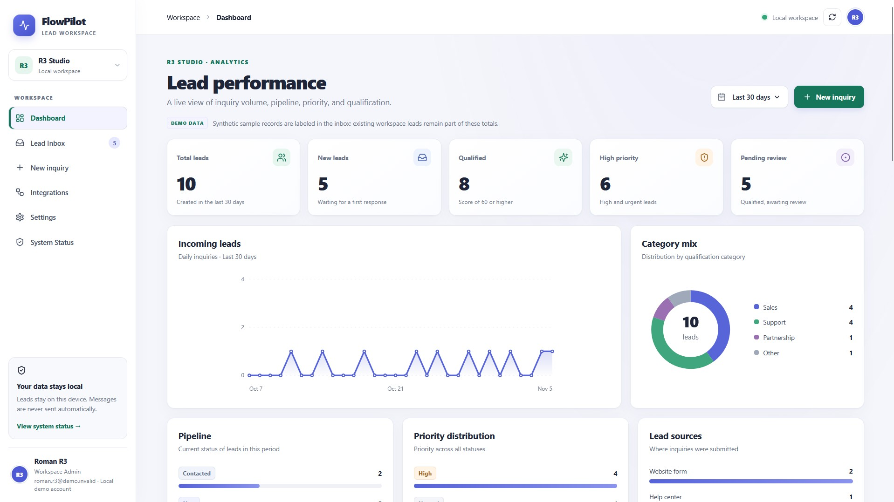
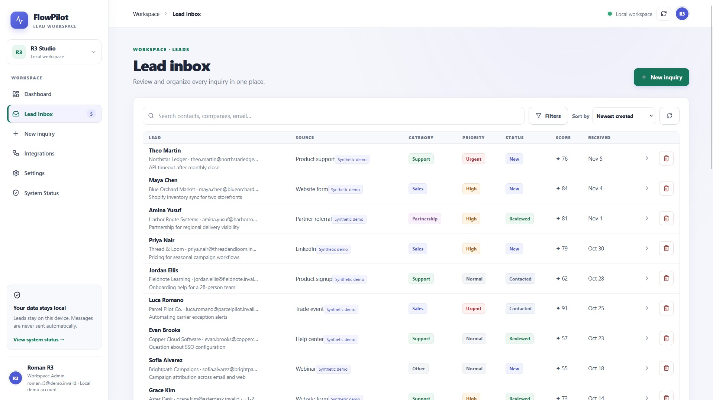
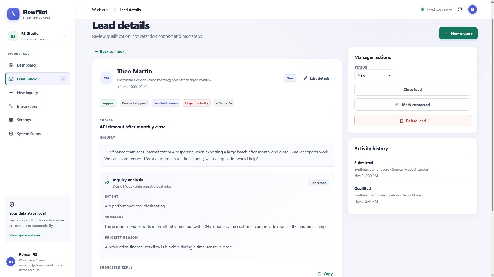
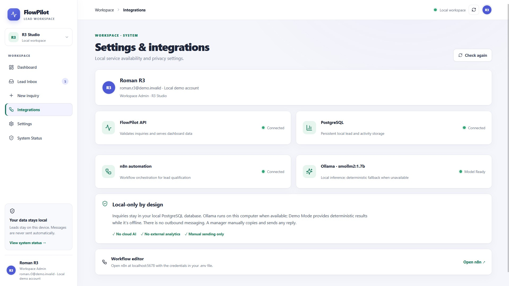
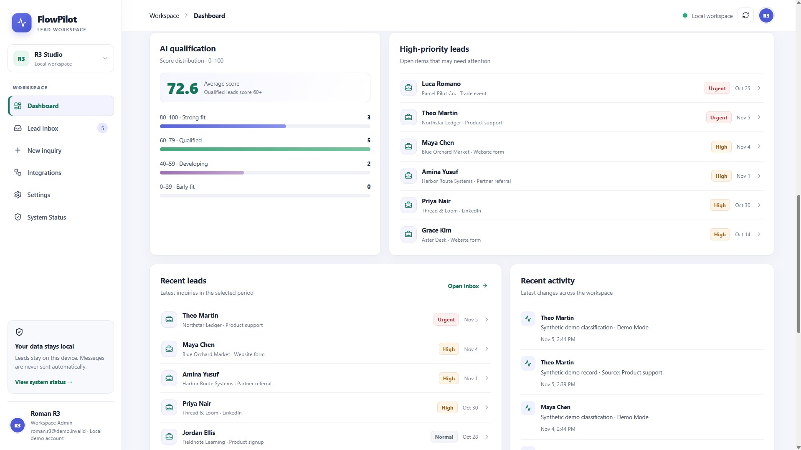
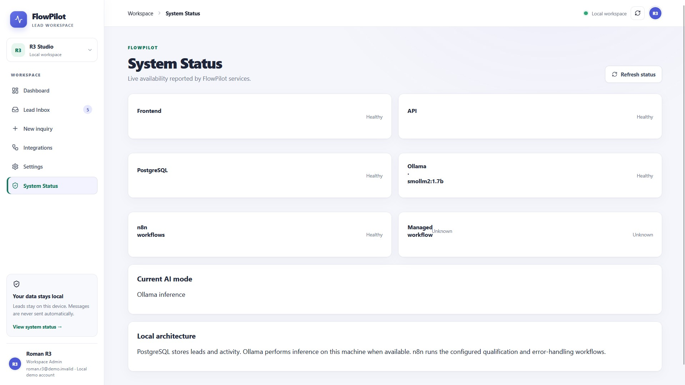

# FlowPilot

**A local-first lead workspace for small teams.** Capture inquiries, identify duplicates, and turn unstructured messages into reviewable next steps with local AI.

FlowPilot is an independent portfolio project that demonstrates a complete lead qualification workflow while keeping data and inference on your own machine. Managers stay in control: suggested replies are drafts, and FlowPilot never sends messages automatically.

<em>Dashboard · lead volume, qualification breakdowns and activity trends</em>

[Product overview PDF](docs/assets/FlowPilot-product-overview.pdf) · [Architecture](docs/ARCHITECTURE.md) · [Product overview](docs/PRODUCT_OVERVIEW.md)

## What FlowPilot does

- **Capture and persist inquiries** in PostgreSQL through a validated API and a public lead form.
- **Detect likely duplicates** using normalized email addresses.
- **Qualify locally** with Ollama, producing intent, summary, priority, score and a suggested reply.
- **Keep work reviewable** with searchable and filterable leads, editable records, status changes and activity history.
- **Give managers context** through dashboard summaries and 7, 30 or 90-day analytics.
- **Show service health** for the API, database, n8n and Ollama integrations.

## Product tour

| Dashboard and analytics | Lead inbox |
|---|---|
|  |  |
| Review volume, priority and trends. | Find and filter leads, then open a record. |

| Lead details | Integrations and preferences |
|---|---|
|  |  |
| Inspect qualification, edit details and track activity. | Configure the workspace and inspect connected services. |

| AI review board | System status |
|---|---|
|  |  |
| Review AI-assisted classifications and suggested replies. | Check API, database, n8n and Ollama health. |

## How it works

**CAPTURE → QUALIFY → REVIEW → DECIDE**

1. **Capture** — the API validates and stores an inquiry before starting qualification.
2. **Qualify** — n8n can dispatch the job to Ollama; validated structured results are persisted. If the workflow or model is unavailable, deterministic local Demo Mode keeps the lead reviewable.
3. **Review** — a manager checks the classification, summary and suggested reply, then edits the lead or changes its status.
4. **Decide** — the manager chooses what happens next. Sending remains outside the app and under human control.

## Architecture

~~~mermaid
flowchart LR
  Visitor[Inquiry form] --> API[Node.js + Express API]
  UI[React + TypeScript workspace] --> API
  API --> DB[(PostgreSQL)]
  API -->|qualification job| N8N[n8n workflow]
  N8N --> OLLAMA[Ollama local model]
  N8N -->|validated result| API
  API -->|fallback if unavailable| Rules[Deterministic Demo Mode]
  API --> DB
~~~

See [docs/ARCHITECTURE.md](docs/ARCHITECTURE.md) for service boundaries, data flow and local deployment details.

## Technology

| Layer | Technologies |
|---|---|
| Web | React 18, TypeScript, Vite |
| API | Node.js, Express, TypeScript, Zod |
| Data | PostgreSQL 16 |
| Qualification | Ollama local inference, deterministic fallback |
| Workflow | n8n |
| Local deployment | Docker Compose |

## Local-first by design

- PostgreSQL, n8n and Ollama data use local Docker volumes.
- Compose publishes service ports on 127.0.0.1.
- Ollama inference runs on the local machine; no hosted AI provider is configured.
- Demo records are fictional and use reserved .invalid email addresses.
- Suggested replies require human review. There is no automatic outbound messaging.

## Demo Mode

If Ollama is missing or unavailable, FlowPilot uses deterministic local rules to produce a predictable qualification result. The interface labels this as Demo Mode so it is not confused with model inference. API-level fallback also covers an unavailable n8n webhook. Demo Mode keeps the workflow demonstrable; it is not intended to represent model quality.

## Run locally

### Requirements

- Windows with Docker Desktop and its Linux engine
- Node.js and npm for optional development outside Docker

### Docker quick start (Windows)

1. Start Docker Desktop.
2. Run RUNLOCALLY.bat from the repository root. On first launch it creates local .env secrets, initializes PostgreSQL and the n8n database, starts services, imports workflows and pulls the configured Ollama model.
3. Open http://localhost:5173. Create a local n8n owner account at http://localhost:5678 if prompted.
4. Optionally add the fictional sample dataset with docker compose exec -T api npm run seed.
5. Stop the services with STOPLOCALLY.bat. Docker volumes preserve local data.

The seeder adds 24 synthetic leads and is idempotent. It is optional.

### Development

Install dependencies with npm install, configure DATABASE_URL for a local PostgreSQL instance, apply api/sql/init.sql, then run:

~~~sh
npm run dev
~~~

Without PostgreSQL, persisted leads, dashboard data and intake are unavailable. If Ollama is unavailable, qualification falls back to Demo Mode.

## Configuration

The checked-in [.env.example](.env.example) documents the supported local settings. RUNLOCALLY.bat generates a local .env on first run; keep that file private. Common settings include PostgreSQL credentials, local service ports, the Ollama model, n8n credentials and the n8n webhook/API key. Compose requires the database passwords and n8n encryption key. See [docker-compose.yml](docker-compose.yml) for service wiring and defaults.

## Tests and build

Use the repository scripts:

~~~sh
npm test
npm run build
docker compose config
~~~

On Windows, TESTLOCALLY.bat runs the unit tests, production builds and Compose configuration check together. Docker-based service health checks require Docker Desktop's Linux engine to be available.

## Project status

FlowPilot is an independent portfolio demonstration, not a commercial deployment. The repository includes unit tests and local service health checks, but it makes no claims about production customers, deployments or business outcomes. Review [Product overview](docs/PRODUCT_OVERVIEW.md) and the [presentation PDF](docs/assets/FlowPilot-product-overview.pdf).

## License

No license is currently declared. Contact the repository owner before reusing this project.
